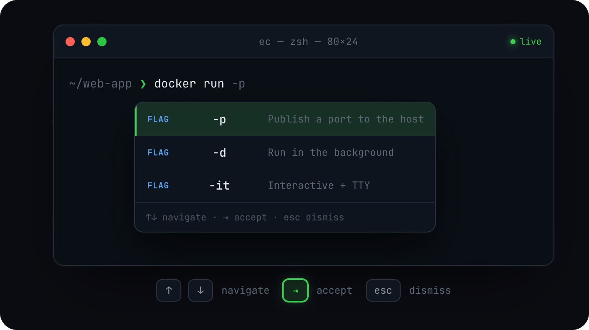

<p align="center">
  
</p>

<h1 align="center">Easy Complete</h1>

<p align="center">
  <b>IDE-style inline autocomplete for your macOS terminal.</b><br/>
  An open-source, Fig-style completion engine for <code>zsh</code>, <code>bash</code> & <code>fish</code>.
</p>

<p align="center">
  <a href="https://github.com/chen86860/easy-complete/releases"></a>
  
  
  <a href="#-license"></a>
  <a href="https://github.com/chen86860/easy-complete/stargazers"></a>
</p>

<p align="center">
  <a href="https://easy-complete.emmmm.dev">Website</a> ·
  <a href="https://github.com/chen86860/easy-complete/releases/latest">Download</a> ·
  <a href="./CHANGELOG.md">Changelog</a> ·
  <a href="./AGENTS.md">Contributing</a>
</p>

<p align="center">
  <b>English</b> · <a href="./README.zh-CN.md">简体中文</a>
</p>

**Easy Complete** gives your shell fish-style suggestions for hundreds of CLIs (`git`,
`npm`, `docker`, `cargo`, …) — subcommands, flags, arguments and file paths, rendered in a
native overlay that follows your cursor. A lightweight, local-first alternative to Fig.

Completion runs on-device, with no account and no AI requests. Anonymous usage statistics
(never command content) can be turned off with `ec telemetry disable`; the
[Privacy page](https://easy-complete.emmmm.dev/privacy-policy) lists every network request
and how to disable it.

<p align="center">
  
</p>

## ✨ Features

- **IDE-style inline completions** for hundreds of CLIs, in a native overlay that follows
  your terminal cursor.
- **Ready out of the box** — completions for every supported CLI come with the app, so
  there is nothing to download or configure.
- **Works where you already type** — standalone terminals, IDE terminals, tmux and Zellij
  (see [Supported terminals](#supported-terminals)).
- **`zsh`, `bash` and `fish`** — shell integration is installed and managed for you.

## 💻 Requirements

- macOS 12 (Monterey) or later, Apple Silicon (the published DMG is arm64 only)
- `zsh`, `bash` or `fish`
- **Accessibility** permission (see [below](#grant-accessibility-permission))

## ⚡ Install

### Homebrew (recommended)

```bash
brew install --cask chen86860/tap/easy-complete
```

### DMG

[Download the latest DMG](https://github.com/chen86860/easy-complete/releases/latest/download/Easy-Complete-arm64.dmg),
drag **Easy Complete.app** into `/Applications`, launch it and follow the same setup panel.

### Build from source

```bash
git clone https://github.com/chen86860/easy-complete.git
cd easy-complete
./scripts/install.sh   # builds, installs to /Applications, sets up shell integration
exec $SHELL
```

### Grant Accessibility permission

Positioning the popup next to your terminal cursor requires the macOS **Accessibility**
permission. Approve **Easy Complete** in:

> System Settings → Privacy & Security → Accessibility

If completions never appear, this is almost always the cause. Run `ec doctor` to check,
or re-trigger the system prompt with `ec debug prompt-accessibility`.

## 🚀 Usage

Start typing in any supported terminal — suggestions appear inline.

| Key             | Action                            |
| --------------- | --------------------------------- |
| `↑` / `↓`       | Move through suggestions          |
| `⇥` (Tab) / `→` | Accept the highlighted suggestion |
| `Esc`           | Dismiss the popup                 |

Settings live in the **Easy Complete menu bar icon**. Useful CLI commands:

```bash
ec doctor                              # diagnose common problems
ec diagnostic                          # print environment / integration status
ec integrations install input-method   # (re)register the macOS input method
ec settings list                       # view settings
ec settings <key> <value>              # change a setting
```

### Supported terminals

| How it works                                      | Terminals                                                                                                                                                                                                                                                                                         |
| ------------------------------------------------- | ------------------------------------------------------------------------------------------------------------------------------------------------------------------------------------------------------------------------------------------------------------------------------------------------- |
| PTY integration, out of the box                   | [iTerm2](https://iterm2.com/), [Apple Terminal](https://support.apple.com/guide/terminal/welcome/mac), [VS Code](https://code.visualstudio.com/) and editors built on it ([Cursor](https://cursor.com/), Windsurf, Trae, [Kiro](https://kiro.dev/)), [ChatGPT (Codex)](https://openai.com/codex/) |
| Plus the bundled input method for cursor tracking | [Ghostty](https://ghostty.org/), [Kitty](https://sw.kovidgoyal.net/kitty/), [WezTerm](https://wezterm.org/), [Zed](https://zed.dev/), [Alacritty](https://alacritty.org/), [Otty](https://otty.sh/), [Herdr](https://herdr.dev/), [JetBrains IDEs](https://www.jetbrains.com/)                    |
| Multiplexers                                      | [tmux](https://github.com/tmux/tmux), [Zellij](https://zellij.dev/) (including resurrected sessions)                                                                                                                                                                                              |

The input method is registered automatically during setup.

## 🗑 Uninstall

```bash
ec uninstall
```

This removes the shell and terminal integrations, the input method (only Easy Complete's
own input source), the LaunchAgent and application data — but not the app itself. Finish
with the step for your install method, then run `exec $SHELL`:

| Installed via | Then run                                                                   |
| ------------- | -------------------------------------------------------------------------- |
| Homebrew      | `brew uninstall --cask chen86860/tap/easy-complete`                        |
| DMG           | Move `/Applications/Easy Complete.app` to the Trash                        |
| Source        | `./scripts/uninstall.sh` from the repo (does everything above in one pass) |

## 🛠 Development

Easy Complete is three cooperating processes: the desktop app (`easy-complete`, overlay and
settings UI), a pseudoterminal (`ecterm`) that reads the shell edit buffer, and the `ec`
CLI. They talk over Unix sockets using Protobuf.

[AGENTS.md](./AGENTS.md) is the full architecture and contributor guide: toolchain, crate
map, IPC, build and test commands, bundled specs and the release process. To get a local
build running:

```bash
./scripts/install.sh    # build and install the app
pnpm dev:autocomplete   # watch the autocomplete UI (port 3124)
```

## 🤝 Contributing

Issues and pull requests are welcome.

- **Report a bug** — `ec issue` opens a pre-filled report with your diagnostics attached,
  or use the [issue templates](https://github.com/chen86860/easy-complete/issues/new/choose).
  Please include `ec doctor` output.
- **Before opening a PR** — make sure `cargo clippy --locked --workspace -- -D warnings`,
  `cargo fmt`, `pnpm lint` and `pnpm test` all pass. Commits follow
  [Conventional Commits](https://www.conventionalcommits.org/).
- **Security issues** — follow [SECURITY.md](./SECURITY.md) instead of filing a public issue.

## 📜 License

Licensed under the MIT License. Easy Complete is based on the upstream Amazon Q
Developer CLI; its original copyright notice is retained in [LICENSE](./LICENSE).
Third-party copyright and license terms are collected in
[THIRD_PARTY_NOTICES.txt](./THIRD_PARTY_NOTICES.txt).
