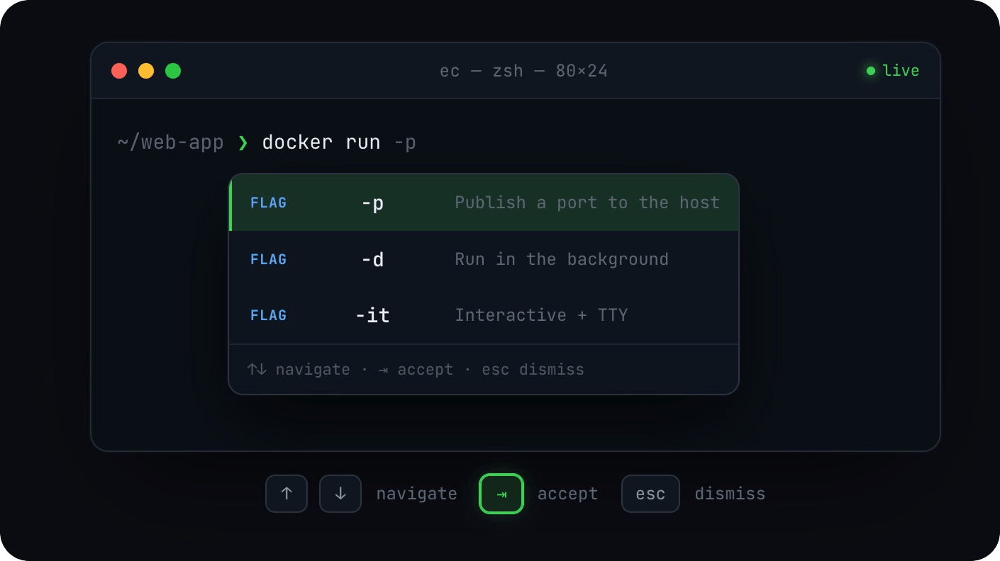

<p align="center">
  
</p>

<h1 align="center">Easy Complete</h1>

<p align="center">
  <b>为 macOS 终端打造的 IDE 风格行内自动补全。</b><br/>
  一款开源、纯本地、Fig 风格的命令行补全引擎，支持 <code>zsh</code>、<code>bash</code> 与 <code>fish</code>。
</p>

<p align="center">
  <a href="https://github.com/chen86860/easy-complete/releases"></a>
  
  
  <a href="#-许可证"></a>
  <a href="https://github.com/chen86860/easy-complete/stargazers"></a>
</p>

<p align="center">
  <a href="https://easy-complete.emmmm.dev">官网</a> ·
  <a href="https://github.com/chen86860/easy-complete/releases/latest">下载</a> ·
  <a href="./CHANGELOG.zh-CN.md">更新日志</a> ·
  <a href="./AGENTS.md">参与贡献</a>
</p>

<p align="center">
  <a href="./README.md">English</a> · <b>简体中文</b>
</p>

**Easy Complete** 在你输入 `git`、`npm`、`docker`、`cargo` 等数百种命令行工具时，提供类似
fish shell 的建议——子命令、选项、参数和文件路径，以跟随光标的原生浮层呈现。一款轻量、
本地优先的 Fig 替代品。

补全在本机运行，无需账号，也没有 AI 请求。匿名使用统计（绝不包含命令内容）可通过
`ec telemetry disable` 关闭；所有联网请求及其关闭方式见
[隐私页面](https://easy-complete.emmmm.dev/privacy-policy)。

<p align="center">
  
</p>

## ✨ 功能特性

- **IDE 风格的行内补全** —— 覆盖数百种 CLI，以跟随终端光标的原生浮层呈现。
- **开箱即用** —— 所有支持的命令行工具的补全都随应用附带，无需额外下载或配置。
- **兼容你正在用的终端** —— 独立终端、IDE 内置终端、tmux 与 Zellij 均可用
  （见[受支持的终端](#受支持的终端)）。
- **支持 `zsh`、`bash` 与 `fish`** —— Shell 集成由应用自动安装与维护。

## 💻 系统要求

- macOS 12（Monterey）及以上，Apple Silicon（当前发布的 DMG 仅支持 arm64）
- `zsh`、`bash` 或 `fish`
- **辅助功能**权限（见[下文](#授予辅助功能权限)）

## ⚡ 安装

### Homebrew（推荐）

```bash
brew install chen86860/tap/easy-complete
```

### DMG

[下载最新版 DMG](https://github.com/chen86860/easy-complete/releases/latest/download/Easy-Complete-arm64.dmg)，
把 **Easy Complete.app** 拖到 `/Applications`，启动后按同样的设置面板完成配置。

### Beta 版

每个正式版发布前会先推出预览版。想提前体验，在设置的「关于」页打开**接收 Beta 版更新**，
或运行：

```bash
ec settings app.betaUpdates true
```

下一个正式版发布后会自动更新到正式版。非常欢迎反馈 Beta 版的问题。

### 从源码构建

```bash
git clone https://github.com/chen86860/easy-complete.git
cd easy-complete
./scripts/install.sh   # 构建、安装到 /Applications，并配置 shell 集成
exec $SHELL
```

### 授予「辅助功能」权限

把补全浮层定位到终端光标旁需要 macOS 的**辅助功能（Accessibility）**权限。请在以下位置
勾选 **Easy Complete**：

> 系统设置 → 隐私与安全性 → 辅助功能

**如果补全始终不出现，几乎都是这个权限没授予。** 可用 `ec doctor` 检查，或用
`ec debug prompt-accessibility` 重新触发授权弹窗。

## 🚀 使用

在任意受支持的终端里直接输入，建议会实时出现在行内。

| 按键        | 操作                                             |
| ----------- | ------------------------------------------------ |
| `↑` / `↓`   | 在建议间移动（也可用 `⇧⇥`、`⌃P` / `⌃N`）         |
| `↩`（回车） | 采用高亮的建议                                   |
| `⇥` (Tab)   | 补全所有建议共有的前缀；没有共同前缀时移到下一项 |
| `Esc`       | 关闭补全浮层                                     |

设置入口在**菜单栏的 Easy Complete 图标**。常用 CLI 命令：

```bash
ec doctor                              # 诊断常见问题
ec diagnostic                          # 打印环境 / 集成状态
ec integrations install input-method   # （重新）注册 macOS 输入法
ec settings list                       # 查看设置
ec settings <key> <value>              # 修改某项设置
```

### 受支持的终端

| 接入方式               | 终端                                                                                                                                                                                                                                                                                               |
| ---------------------- | -------------------------------------------------------------------------------------------------------------------------------------------------------------------------------------------------------------------------------------------------------------------------------------------------- |
| PTY 集成，开箱即用     | [iTerm2](https://iterm2.com/)、[Apple Terminal](https://support.apple.com/zh-cn/guide/terminal/welcome/mac)、[VS Code](https://code.visualstudio.com/) 及基于它的编辑器（[Cursor](https://cursor.com/)、Windsurf、Trae、[Kiro](https://kiro.dev/)）、[ChatGPT（Codex）](https://openai.com/codex/) |
| 另需随附输入法追踪光标 | [Ghostty](https://ghostty.org/)、[Kitty](https://sw.kovidgoyal.net/kitty/)、[WezTerm](https://wezterm.org/)、[Zed](https://zed.dev/)、[Alacritty](https://alacritty.org/)、[Otty](https://otty.sh/)、[Herdr](https://herdr.dev/)、[JetBrains 系列 IDE](https://www.jetbrains.com/)                 |
| 终端复用器             | [tmux](https://github.com/tmux/tmux)、[Zellij](https://zellij.dev/)（含恢复的会话）                                                                                                                                                                                                                |

输入法会在设置过程中自动注册。

## 🗑 卸载

```bash
ec uninstall
```

它会移除 Shell 与终端集成、输入法（只移除 Easy Complete 自己的输入源）、LaunchAgent 和应用
数据，但不删除应用本身。请按安装方式执行对应的收尾步骤，最后运行 `exec $SHELL`：

| 安装方式 | 收尾命令                                                      |
| -------- | ------------------------------------------------------------- |
| Homebrew | `brew uninstall chen86860/tap/easy-complete`                  |
| DMG      | 把 `/Applications/Easy Complete.app` 移到废纸篓               |
| 源码     | 在仓库中执行 `./scripts/uninstall.sh`（一步完成上述全部清理） |

## 🛠 开发

Easy Complete 由三个协作进程组成：桌面应用（`easy-complete`，承载补全浮层和设置界面）、读取
shell 编辑缓冲区的伪终端（`ecterm`），以及 `ec` CLI，三者通过 Unix 套接字以 Protobuf 通信。

[AGENTS.md](./AGENTS.md) 是完整的架构与贡献指南：工具链、crate 索引、IPC、构建与测试命令、
内置 spec 和发布流程都在其中。跑通本地构建：

```bash
./scripts/install.sh    # 构建并安装应用
pnpm dev:autocomplete   # 监听补全 UI（端口 3124）
```

## 🤝 参与贡献

欢迎提交 Issue 和 Pull Request。

- **反馈问题** —— 运行 `ec issue` 会打开已附带诊断信息的 Issue 表单，也可以直接使用
  [Issue 模板](https://github.com/chen86860/easy-complete/issues/new/choose)。请附上 `ec doctor` 的输出。
- **新增或修正某个 CLI 的补全** —— 补全规则是
  [`packages/autocomplete-specs/src`](./packages/autocomplete-specs/src) 下的 TypeScript 文件，
  每个 CLI 一个。新建 spec、边改边在应用里生效，以及如何随应用发布，见该目录的
  [README](./packages/autocomplete-specs/README.md)。
- **提 PR 之前** —— 确认 `cargo clippy --locked --workspace -- -D warnings`、`pnpm lint` 和
  `pnpm test` 全部通过。不用手动格式化：机器人会格式化每个 PR 并把结果提交回去（本地可运行
  `pnpm format`，效果相同）。提交信息遵循
  [Conventional Commits](https://www.conventionalcommits.org/)。
- **安全问题**请按 [SECURITY.md](./SECURITY.md) 的流程反馈，不要提交公开 Issue。

## 📜 许可证

采用 MIT 许可证。Easy Complete 基于上游 Amazon Q Developer CLI，并在
[LICENSE](./LICENSE) 中保留其原始版权声明。
第三方版权与许可证条款集中收录于
[THIRD_PARTY_NOTICES.txt](./THIRD_PARTY_NOTICES.txt)。

许可证只覆盖代码，不包括 Easy Complete 的名称、Logo 和图标。发布 fork 时须更换名称和图标，详见
[TRADEMARKS.zh-CN.md](./TRADEMARKS.zh-CN.md)。

## 🙏 致谢

补全规则最初来自 [withfig/autocomplete](https://github.com/withfig/autocomplete)，spec 依赖库和
构建工具来自 [withfig/autocomplete-tools](https://github.com/withfig/autocomplete-tools)，两者均由
Fig 及其贡献者以 MIT 许可证发布。感谢所有编写和维护它们的人。
