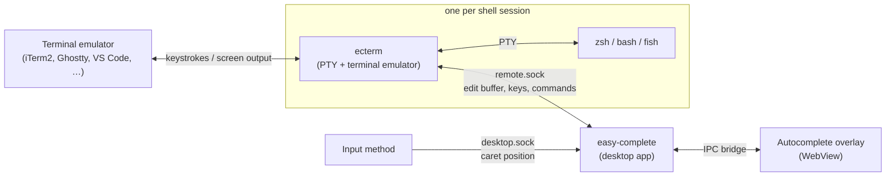

# How Easy Complete Works

Easy Complete shows an IDE-style completion menu in a terminal that knows nothing about it.
It does that without a terminal plugin and without patching the shell's line editor. It reads
what the terminal displays, works out what you are typing, and types the chosen completion
back in for you.

This document follows one keystroke through the system. For the crate map, build commands
and release process, see [AGENTS.md](../AGENTS.md).

## The pieces

| Process | Crate | What it does |
| --- | --- | --- |
| `ecterm` | `figterm` | A pseudoterminal (PTY) that sits between the terminal emulator and your shell. One per shell session. It reads the edit buffer and injects keystrokes. |
| `easy-complete` | `fig_desktop` | The menu-bar app. It owns the overlay window, finds the caret on screen, and routes messages between the overlay and the sessions. |
| Autocomplete overlay | `packages/autocomplete-app` | A React app in a `wry` WebView. It parses the command line, loads the spec and builds the suggestions. |
| `EasyCompleteInputMethod` | `fig_input_method` | A macOS input method. It reports the caret position for terminals that do not expose it through Accessibility. |
| `ec` | `ec_cli` | The CLI. The shell integration calls it (`ec init`, `ec _ pre-cmd`). Users call it for settings and diagnostics. |

The processes talk over Unix domain sockets with Protobuf messages (`proto/` → `fig_proto`).



## 1. Getting between the terminal and the shell

Setup adds a `pre` and a `post` block to your shell rc files (`.zshrc`, `.bashrc`, fish
config). Their templates are in `crates/fig_integrations/src/shell/scripts/`.

When an interactive shell starts, the `pre` block (`pre.sh`) checks a few conditions. Stdin
and stdout must be TTYs, `ecterm` must be on `PATH`, and the shell must not already be
running inside an `ecterm` (`Q_TERM` is set, or `Q_TERM_TMUX` inside tmux). If all of them
hold, it runs `exec ecterm`, so `ecterm` replaces the shell that was starting up.

`ecterm` then:

1. Opens a new PTY sized to the terminal window.
2. Starts your real shell on the PTY's slave side, with `Q_TERM` set so the `pre` block does
   not launch another `ecterm`.
3. Switches the outer terminal to raw mode and relays bytes in both directions. Keystrokes go
   from the terminal to the shell, and output from the shell goes to the terminal.

From then on the terminal emulator talks to `ecterm`, and the shell thinks `ecterm` is its
terminal.

`ec init` prints nothing when the desktop app is not running, so a terminal opened while the
app is down stays a plain shell for its whole session.

## 2. Marking the prompt

Raw terminal output is just text and escape codes. `ecterm` cannot tell the prompt from what
you typed, so the `post` block marks the prompt for it. It wraps your prompt variables (`PS1`,
`PROMPT`, `RPROMPT`, …) in private OSC escape sequences, `ESC ] 697 ; … BEL`:

```text
OSC 697;StartPrompt  <your prompt>  OSC 697;EndPrompt  OSC 697;NewCmd=<session id>
```

The terminal emulator ignores these sequences, so nothing changes on screen. On every new
prompt the hooks also report the shell's context the same way: `Dir=`, `PID=`, `TTY=`,
`ExitCode=`, `Shell=`, `User=`, and so on. Before a command runs, they send `PreExec`. In
zsh these come from the `precmd` and `preexec` hooks, in bash from bash-preexec, and in fish
from event handlers.

`ec _ pre-cmd --alias "$(alias)"` runs in the background on each prompt, so suggestions can
take your aliases into account.

## 3. Reading the edit buffer

`ecterm` runs a full terminal emulator: a vendored fork of `alacritty_terminal`, extended to
understand OSC 697. Every byte the shell writes goes through it before it reaches your real
terminal, so `ecterm` keeps its own copy of the screen grid.

- **`StartPrompt` / `EndPrompt`** flag every cell written in between as `IN_PROMPT`.
- **`NewCmd`** records the cursor position at that moment as `cmd_cursor`, the place where
  your input starts.
- **`PreExec`** marks that a command is running, which pauses completion until the next
  prompt.

The edit buffer is the text on screen from `cmd_cursor` to the end of the screen, without
the following cells (`Term::get_current_buffer` in
`crates/alacritty_terminal/src/term/mod.rs`):

- cells flagged `IN_PROMPT`, such as a right prompt (`RPROMPT`);
- cells flagged `IN_SUGGESTION`: zsh-autosuggestions' grey ghost text, recognised by the
  `ZSH_AUTOSUGGEST_HIGHLIGHT_STYLE` color that the hook reports.

The position of the terminal cursor within that text gives the cursor index.

So the buffer is read from what the shell echoes back, not from the keys you pressed. This
works for every line editor (zle, readline, fish's). History recall, `Ctrl+R`, pasted text and
the shell's own completion all appear in the buffer with no extra work.

After each chunk of shell output, `ecterm` sends the buffer and the shell context to the
desktop app as an `EditBufferHook`. It skips this when a command is running (`preexec`), when
the shell is not a supported one, or when `Q_DISABLE_AUTOCOMPLETE` is set.

## 4. Showing the overlay

Every `ecterm` connects to the desktop app's session socket, `$TMPDIR/ecrun/remote.sock`
(`fig_remote_ipc`). When the app receives an edit buffer
(`crates/fig_desktop/src/remote_ipc/mod.rs`), it:

1. Stores the buffer, cursor and context on that session.
2. Forwards an `EditBufferChangedNotification` to the overlay WebView.
3. Shows the overlay window, or hides it if the buffer is empty.
4. Moves the window next to the caret.

A `PreExec` from the session hides the overlay. So do focus moving to another pane and the
terminal window closing.

### Finding the caret

A terminal does not tell other apps where its text cursor is, so the app uses one of three
strategies, chosen by the terminal's bundle ID (`refresh_window_position` in
`crates/fig_desktop/src/platform/macos.rs`):

| Terminals | How the caret is found |
| --- | --- |
| iTerm2, Apple Terminal and others with Accessibility support | The macOS Accessibility API: the bounds of the focused element's selected text range (`kAXBoundsForRangeParameterizedAttribute`, `crates/macos-utils/src/caret_position.rs`). |
| xterm.js terminals: VS Code and its forks (Cursor, Windsurf, Trae, …), Hyper, Tabby | A walk of the Accessibility tree for the caret element that xterm.js renders, then that element's frame. |
| Ghostty, kitty, WezTerm, Alacritty, Zed, JetBrains IDEs, … (`Terminal::supports_macos_input_method`) | The input method. The app posts a distributed notification. The input method, which runs inside the terminal's text input context, asks the terminal for the caret rectangle (`attributesForCharacterIndex:lineHeightRectangle:`) and sends a `CaretPositionHook` to `$TMPDIR/ecrun/desktop.sock`. |

All three strategies need the Accessibility permission. The overlay window is then placed
relative to the caret, at the window level of the focused terminal.

## 5. Building suggestions

The overlay (`packages/autocomplete-app`) does the language work:

1. **Tokenize.** `shell-parser` splits the buffer into commands and arguments, and handles
   quoting, pipes, `&&` and subshells.
2. **Load the spec.** A spec is a description of a CLI's subcommands, options and arguments,
   written in TypeScript (`packages/autocomplete-specs/src`). The specs are compiled and
   bundled into the app at build time. `autocomplete-parser` loads the right one through the
   `spec://localhost/<name>.js` protocol, which reads only from the app bundle; there is no
   network fallback.
3. **Walk the spec.** It matches the tokens against the spec's subcommands and options to find
   what is expected at the cursor: a subcommand, an option, or an argument of some type.
4. **Generate dynamic values.** Arguments such as git branches or npm scripts come from
   *generators*:
   - **template** generators list files and folders;
   - **script** generators run a command, for example `git branch`, and parse its output;
   - **custom** generators are functions that may run several commands.

   A command a generator runs does not run inside the WebView. It goes as a `RunProcess`
   request through the desktop app to that session's `ecterm`, which runs it in the shell's
   current directory and environment, with a timeout (`crates/figterm/src/message.rs`).
   Results are cached per generator.
5. **Rank.** Suggestions are filtered against what you typed with a fuzzy matcher
   (`packages/fuzzysort`), and sorted by priority and by how often you pick them.

## 6. Keys and insertion

The keys you press go to `ecterm` before they reach the shell. Normally `ecterm` passes them
straight through. While the overlay is visible and has suggestions, the overlay calls
`setInterceptKeystrokes`, and the desktop app relays that to `ecterm`. `ecterm`'s
`KeyInterceptor` then holds back the keys bound to overlay actions. It does not pass them to
the shell; it sends an `InterceptedKeyHook` to the app instead. The defaults
(`crates/fig_settings/src/actions.json`):

| Key | Action |
| --- | --- |
| `Enter` | insert the selected suggestion |
| `Tab` | insert the common prefix, or move down |
| `↑` / `Shift+Tab` / `Ctrl+P` / `Ctrl+K` | move up |
| `↓` / `Ctrl+N` / `Ctrl+J` | move down |
| `Esc` | hide the overlay |
| `Ctrl+1` … `Ctrl+0` | pick suggestion 1–10 |
| `⌘I` | toggle the description |

All other keys go to the shell as usual, so typing never blocks on the overlay.

To insert a suggestion, the overlay works out the keystrokes that turn the current buffer into
the completed one: some backspaces (`\b`) to remove the partial token, the new text, and any
cursor movement. It sends them as an `InsertText` request. `ecterm` writes those bytes to the
PTY as if you had typed them (`crates/figterm/src/message.rs`). The shell's line editor
applies them, echoes the result, and section 3 picks up the new buffer.

While the shell catches up, `ecterm` holds back edit-buffer updates for up to 16 ms, or until
the buffer matches what the insertion should produce. This keeps the overlay from flashing a
half-applied state.

## 7. Sockets and files

| Path | Used for |
| --- | --- |
| `$TMPDIR/ecrun/remote.sock` | Session socket. Every `ecterm` connects here; sessions connecting and disconnecting drive the overlay lifecycle. |
| `$TMPDIR/ecrun/desktop.sock` | Desktop app socket for local hooks and commands: the input method's caret position, `ec` CLI commands. |
| `$TMPDIR/ecrun/t/<session-id>.sock` | Per-session socket that `ecterm` listens on. |
| `~/Library/Application Support/easy-complete/settings.json` | Settings (`ec settings`). |
| `~/Library/Application Support/easy-complete/data.sqlite3` | App state. |
| `/Applications/Easy Complete.app/Contents/Resources/specs/` | Bundled completion specs. |

## 8. What this design means in practice

- **No terminal plugin.** Any terminal works if its caret can be found (section 4). Supporting
  a new terminal usually means adding its bundle ID and picking a caret strategy.
- **Shell-agnostic buffer.** Because the buffer is read from the screen, prompt themes,
  multi-line prompts and line-editor plugins mostly just work. When they do not, it is usually
  because something prints into the input area in a way the prompt markers do not cover.
- **Everything is local.** Specs come from the app bundle, and generators run commands on your
  machine in your shell's environment. The only network requests are those a spec's own
  generators make (for example, looking up package names in a registry) and the ones listed
  on the [privacy page](https://easy-complete.emmmm.dev/privacy-policy).
- **The overlay is optional at runtime.** If the desktop app quits, `ecterm` keeps relaying
  bytes and your shell keeps working; you just get no suggestions.

## Where to look in the code

| Topic | Location |
| --- | --- |
| Shell hooks | `crates/fig_integrations/src/shell/scripts/` |
| PTY main loop, edit buffer sending | `crates/figterm/src/main.rs` |
| OSC 697 parsing | `crates/alacritty_terminal/src/ansi.rs` |
| Edit buffer extraction | `crates/alacritty_terminal/src/term/mod.rs` (`get_current_buffer`) |
| Key interception | `crates/figterm/src/interceptor.rs` |
| Insert text, run generator commands | `crates/figterm/src/message.rs` |
| Session hooks in the desktop app | `crates/fig_desktop/src/remote_ipc/mod.rs` |
| Caret positioning | `crates/fig_desktop/src/platform/macos.rs`, `crates/macos-utils/src/caret_position.rs` |
| Input method | `crates/fig_input_method/src/imk.rs` |
| Overlay UI and insertion | `packages/autocomplete-app/src` (`state/insertion.ts`) |
| Spec loading and parsing | `packages/autocomplete-parser/src` |
| Tokenizer | `packages/shell-parser/src` |
